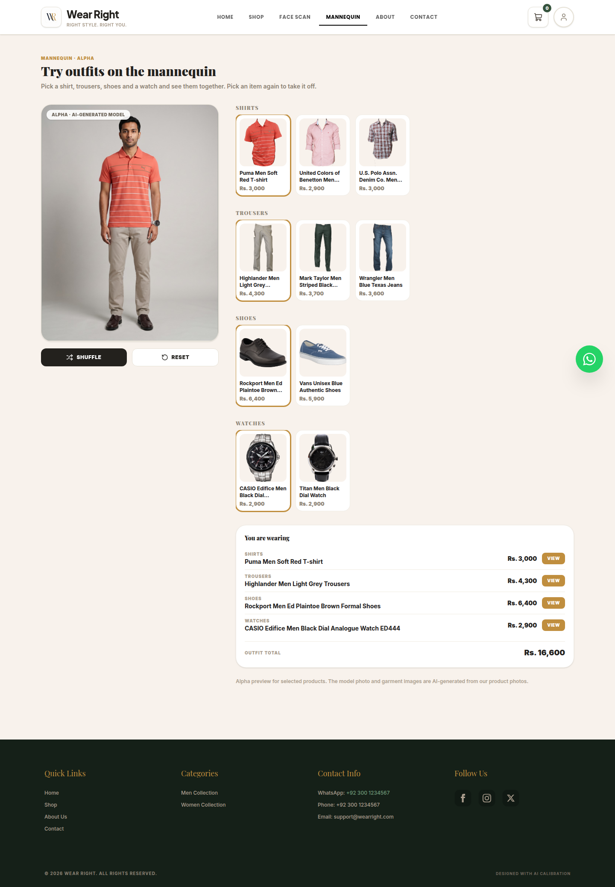
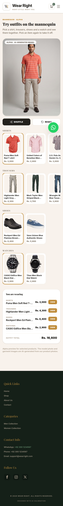
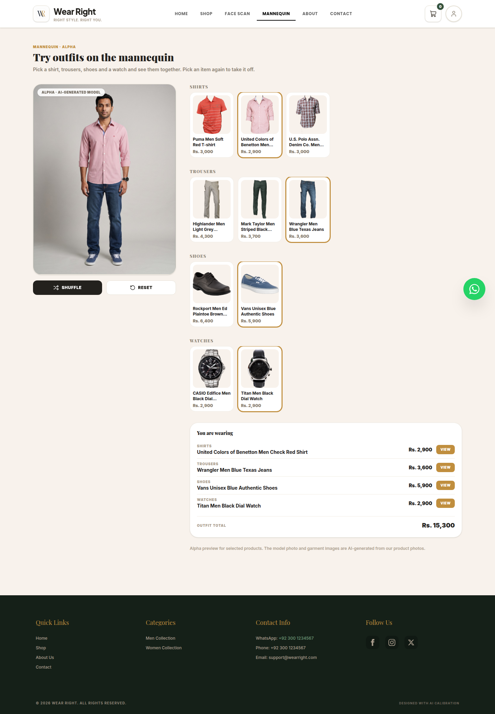
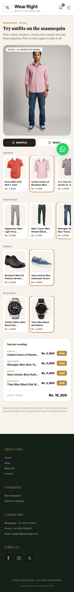
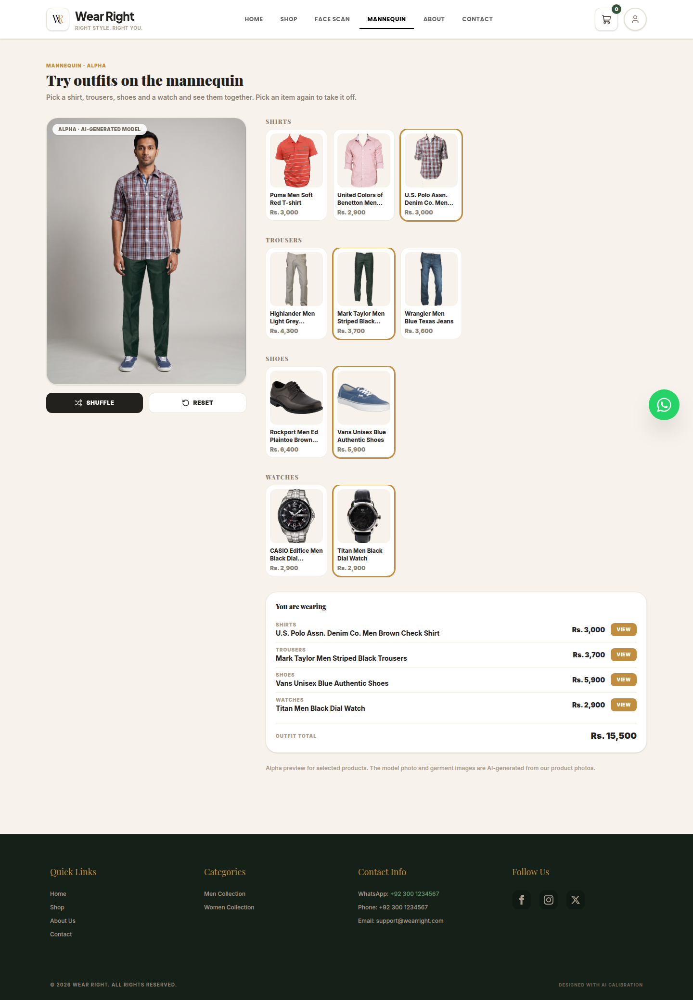
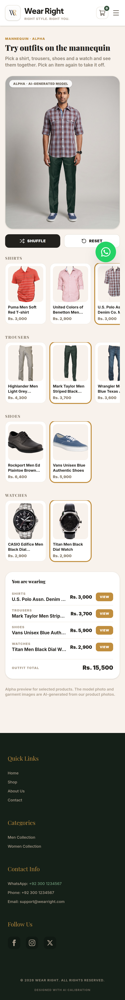

# Phase 6: Basic flat 2D SVG mannequin

Status: done with open items. Date: 2026-10-28. Branch: `feat/password-reset` (plan 02 commit `5766a69`, childrenswear/gender follow-up `cf8fe97`).

## Goal

Replace the grey statue and pasted product photos with a basic 2D mannequin that can draw every product in the catalogue, in the colours the recommender chose, on a body in the shopper's size.

## What changed

- `apps/web/src/features/mannequin/geometry.ts`: one set of body key points per gender, plus `slim | regular | plus` horizontal scaling. Pure data and functions.
- `apps/web/src/features/mannequin/garments.ts`: one vector shape per garment kind (tops, bottoms, outerwear, footwear, accessories), generated from the body points. Shoes return a left and a right path; the watch is drawn at the wrist point.
- `apps/web/src/features/mannequin/layout.ts`: rewritten to layer the anchor and look picks by slot and z-order, drop a second item for an occupied slot, and list undrawable items (bags) separately.
- `apps/web/src/components/Mannequin.tsx`: renders one `<svg viewBox="0 0 400 800">` with exposed `data-part`, `data-testid="mannequin-layer"`, `data-kind`, `data-product-id`, `data-anchor` and `data-foot` hooks. Slim/Regular/Plus remain; the photo Front/Back toggle is gone.
- `CompleteOutfitView.tsx` and `OutfitPreviewModal.tsx` use the new layout and pass the shopper's gender to the look API. The opened product is always a layer, badged "Your pick".
- `catalog/engine/color.py` and `catalog/serializers.py`: `Product.display_hex` gives one colour fallback chain (`color_hex` → `primary_color.hex` → named colour table → grey) for the mannequin and the recommender.
- `public/mannequin/*.png` and `public/mannequin/anchors.json` were deleted. The unused Django mannequin-image pipeline and its tests remain.
- Tests: rewritten `mannequin/layout.test.ts`, new `garments.test.ts` (every kind, both genders, all presets, two shoes, watch overlaps the left wrist, nothing outside the canvas), rewritten `e2e/10-mannequin.spec.ts`, and backend `display_hex` coverage. `catalog/engine/kinds.py` and its tests were tightened so Boys/Girls/Baby/Infant names are childrenswear.

## Decisions and why

- **Draw garments, do not paste photos.** Most admin products have no processed `mannequin_image`, and the pipeline refuses photos of people, so the old mannequin silently skipped the product the shopper opened. A vector shape exists for every product and cannot fail that way.
- **Two shoes and a wrist watch are geometry, not anchor boxes.** The feet and wrists are known points on our own body, so the pair and the watch placement are guaranteed by construction instead of by a hand-tuned box per photo.
- **One front view.** There are no back photos to compose with; a flat back would add work without adding information. The Front/Back control was removed.
- **The anchor owns its slot.** If the look engine or the layout sees a second top, the shopper's opened product wins.
- **The backend photo pipeline stays.** It is unused by the web app but harmless, tested, and may support future work; removing it would be unrelated churn.

## Gates (real output)

Run in this branch on 2026-10-28 after plans 00–03:

```
backend pytest     531 passed, 9 skipped (27.73s)
web vitest         117 passed (13 files, 3.79s)
tsc --noEmit       clean
eslint             0 errors, 2 warnings (unused-disable in AdminView, unused refreshProducts in ShopView)
next build         passed (after the Next.js 16.4.0 security advisory retry)
Playwright         not run here; the lead runs `make e2e` after the branch is reviewed
```

## Real-model checks

None. The mannequin is deterministic geometry; no ML model or weights are involved in this phase.

## Known limitations

- Flat front view only: no back view, draping, fabric, poses or body diversity beyond the three width presets.
- The body is a neutral tone, not the shopper's detected skin tone.
- Bags and unknown accessories are listed under the mannequin, not drawn.
- Garment shapes are a recognisable fashion-flat approximation, not a tailored fit.
- The backend image-compositing pipeline still exists but is no longer reachable from the shop UI.

## How to run it

Open any product in the shop and choose **Preview Outfit**, or open `/complete-outfit`. Switch Slim / Regular / Plus to resize the body.

## Open items for later phases

- Photo-realistic or layered try-on, back view, poses and drape.
- Tint the body with the shopper's detected skin tone.
- Measure whether the mannequin helps shoppers understand an outfit (Phase 8 user study).

## Mannequin (alpha)

Added 2026-11-07 on `feat/mannequin-alpha` as a separate pilot behind `/mannequin`; the SVG mannequin above is unchanged.

**How it works.** The pilot uses one AI-generated model photo (`extras/mannequin-alpha-kit/base/men.png`) and, for each curated product, one Gemini (Nano Banana Pro) edit of that photo with only that item swapped. `manage.py import_alpha_mannequin` (`make alpha-import SOURCE=extras/mannequin-alpha-kit`) aligns every render to the base with OpenCV ECC, cuts the item out as a transparent layer (tops and bottoms with rembg `u2net_cloth_seg`, shoes and watches by colour difference in their band), extends trouser layers under the tee hem, and rejects renders where the person moved. The thresholds live in `catalog/engine/alpha_layers.py`. Layers are stored in `MannequinBase` / `MannequinLayer` under `MEDIA_ROOT/mannequin_alpha/`. `GET /api/mannequin/alpha/?gender=men` returns the base and approved layers by slot; `/mannequin` stacks them as `` layers so any shirt + trousers + shoes + watch combination shows instantly, and alpha products get a "Try it on the mannequin (alpha)" button. Everything is labelled AI-generated; nothing is generated live.

**Real import.** Run on 2026-11-07 against the pilot kit and the shared catalogue:

```text
code  slot    outcome        ecc   shift    keep  note
T1    top     approved     0.999   0.2px   0.29%
T2    top     approved     0.997   0.6px   0.75%
T3    top     approved     0.999   0.5px   0.25%
B1    bottom  approved     0.996   0.4px   0.10%
B2    bottom  approved     0.998   0.3px   0.11%
B3    bottom  approved     0.996   0.3px   0.15%
S1    shoes   approved     0.998   0.3px   0.20%
S2    shoes   approved     0.999   0.4px   0.26%
W1    watch   approved     0.998   0.4px   0.15%
W2    watch   approved     0.997   0.2px   0.16%
Approved 10, unchanged 0, rejected 0, skipped 0.
```

A second run reported all 10 rows as `unchanged`, so re-importing the same kit is idempotent. All ten rows were approved; no rows were skipped, missing, Draft or inactive. Two catalogue labels do not match the kit artwork (for example the "Mark Taylor Men Striped Black Trousers" image and layer are dark green, and the "Puma Men Soft Red T-shirt" artwork is a coral polo). That is existing product data, not an import defect; the product data was not edited.

**Screenshots.** Desktop 1440 px and phone 390 px, three outfits each:

| Outfit | Desktop | Phone |
| --- | --- | --- |
| A: red tee, light grey trousers, brown shoes, CASIO watch |  |  |
| B: pink check shirt, blue jeans, blue shoes, Titan watch |  |  |
| C: brown check shirt, dark green trousers, blue shoes, Titan watch |  |  |

**Limits.**

- Curated pilot set only: ten men's products (three shirts, three trousers, two shoes, two watches). Products without a layer do not get the try-on button.
- Men only: the API accepts `gender=women`, but the pilot has no women's base or layers.
- The model is AI-generated and fixed: one body, one pose, one backdrop. It is not the shopper and does not reflect their size or skin tone.
- Not live try-on: layers are pre-generated edits of the model photo, not a real-time render of the shopper or the product. Fit, drape and fabric behaviour are illustrative.

